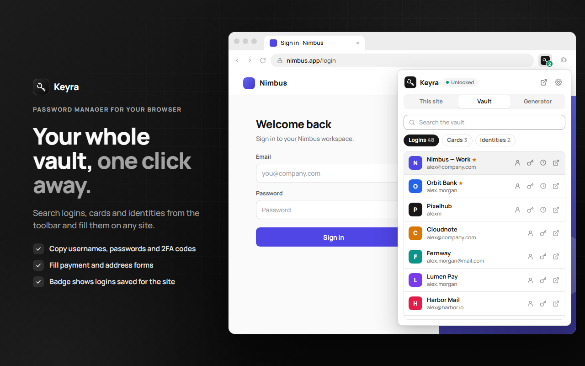
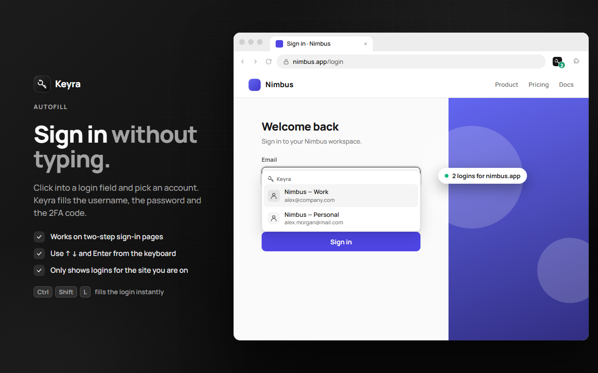
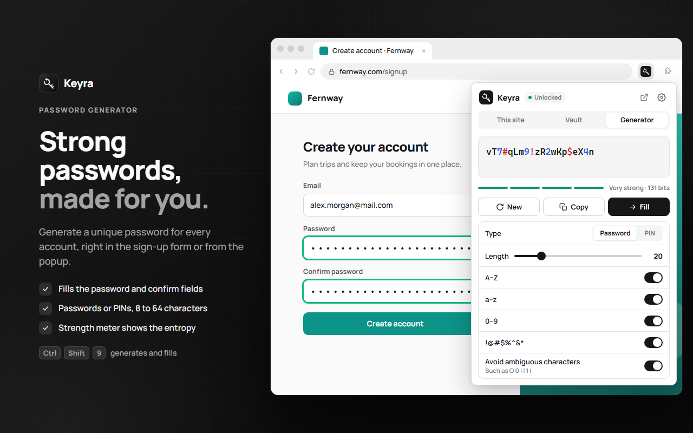
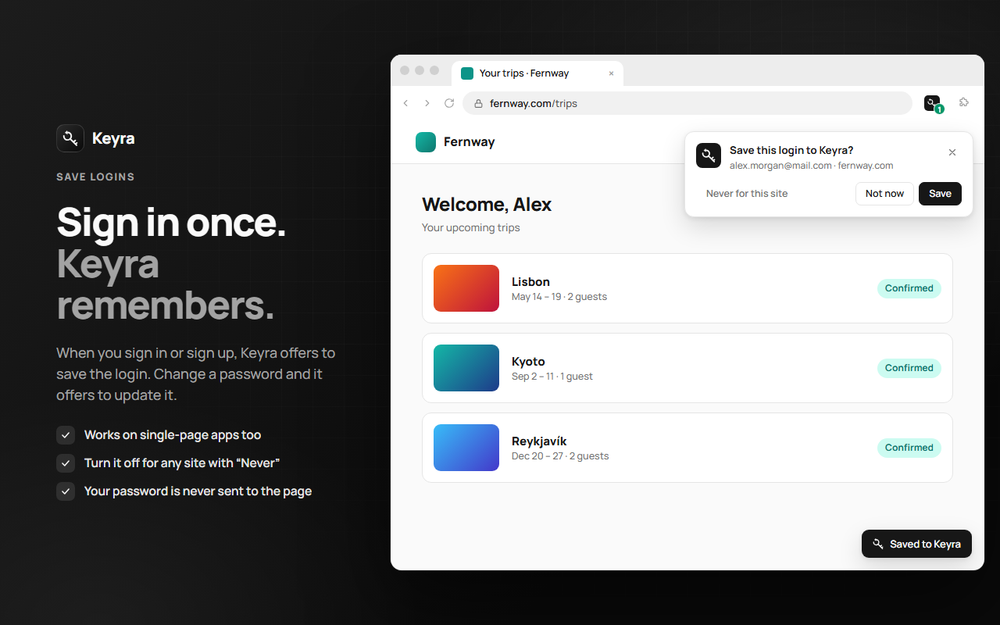
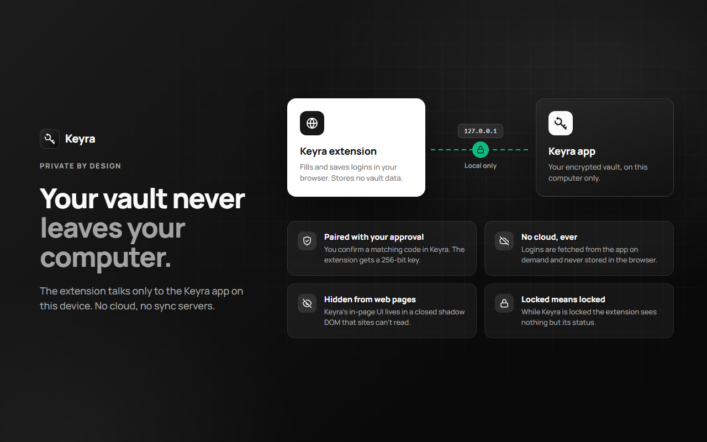

<div align="center">


# Keyra for your browser

**Autofill, login saving and a password generator for the [Keyra](https://github.com/vezironi/keyra-app) password vault.**
<br>
The extension talks only to the Keyra app on your computer. No cloud, no sync servers.




</div>

---

## Features

<table>
<tr>
<td width="50%" valign="top">

### Sign in without typing
Click into a login field and pick an account. Keyra fills the username, the password and the 2FA code.

- Works on two-step sign-in pages
- Navigate with <kbd>↑</kbd> <kbd>↓</kbd> and <kbd>Enter</kbd>
- Only suggests logins for the site you're on

</td>
<td width="50%" valign="top">



</td>
</tr>
<tr>
<td width="50%" valign="top">



</td>
<td width="50%" valign="top">

### Strong passwords, made for you
Generate a unique password right in the sign-up form or from the popup.

- Fills both the password and confirm fields
- Passwords (8–64 characters) or PINs (4–12 digits)
- Unbiased `crypto.getRandomValues` generation with a strength meter

</td>
</tr>
<tr>
<td width="50%" valign="top">

### Sign in once, Keyra remembers
When you sign in or sign up, Keyra offers to save the login. Change a password and it offers to update it.

- Works on single-page apps too
- Turn it off for any site with **Never for this site**
- Your password is never sent to the page

</td>
<td width="50%" valign="top">



</td>
</tr>
</table>

**And more:** search logins, cards and identities from the toolbar · copy usernames, passwords and TOTP codes · fill payment and address forms · a toolbar badge with the number of saved logins for the current site · right-click menu · English and Turkish UI.

## Private by design



| | |
|---|---|
| 🔐 **Paired with your approval** | You confirm a matching code in the Keyra app before the extension gets access. |
| ☁️ **No cloud, ever** | Logins are fetched from the app on demand over `127.0.0.1` and never stored in the browser. |
| 🫥 **Hidden from web pages** | The in-page UI lives in a closed shadow DOM that sites can't read. |
| 🔒 **Locked means locked** | While Keyra is locked, the extension sees nothing but its status. |

## Keyboard shortcuts

| Action | Windows / Linux | macOS |
|---|---|---|
| Open Keyra | <kbd>Ctrl</kbd> <kbd>Shift</kbd> <kbd>Y</kbd> | <kbd>⌘</kbd> <kbd>Shift</kbd> <kbd>Y</kbd> |
| Fill the login for this site | <kbd>Ctrl</kbd> <kbd>Shift</kbd> <kbd>L</kbd> | <kbd>⌘</kbd> <kbd>Shift</kbd> <kbd>L</kbd> |
| Generate and fill a password | <kbd>Ctrl</kbd> <kbd>Shift</kbd> <kbd>9</kbd> | <kbd>⌘</kbd> <kbd>Shift</kbd> <kbd>9</kbd> |

You can change them at `chrome://extensions/shortcuts` (or `about:addons` → ⚙ → *Manage Extension Shortcuts* in Firefox).

## Getting started

> [!NOTE]
> The extension needs the [Keyra desktop app](https://github.com/vezironi/keyra-app) running on the same computer.

### 1. Load the extension

There's no build step: the repo is the extension.

```bash
git clone https://github.com/vezironi/keyra-extension.git
```

**Chrome, Edge, Brave, Opera, Vivaldi**
1. Open `chrome://extensions` and turn on **Developer mode**.
2. Click **Load unpacked** and pick the `keyra-extension` folder.

**Firefox (121+)**
1. Open `about:debugging#/runtime/this-firefox`.
2. Click **Load Temporary Add-on…** and pick `manifest.json`.

### 2. Connect to Keyra

1. Open Keyra and unlock it.
2. Allow the extension in **Settings → Browser**.
3. Click the Keyra icon in the toolbar, press **Connect to Keyra** and approve the matching code in the app.

> [!TIP]
> Opened Keyra with **Try with a test account**? Use **Connect in test mode** in the popup to pair with the sample vault without the approval step. The **Connection test** in settings checks every step end to end.

## How it works

```
┌──────────────────────┐         HTTP + token          ┌──────────────────────┐
│   Keyra extension    │ ────────────────────────────▶ │      Keyra app       │
│                      │     127.0.0.1:47390/v1        │                      │
│  popup · background  │ ◀──────────────────────────── │  encrypted vault     │
│  content script      │        JSON results           │  (Tauri, local only) │
└──────────────────────┘                               └──────────────────────┘
```

The extension stores only its pairing token and your settings in `chrome.storage.local`. Every vault read goes through the app, which refuses requests while it's locked.

### Project layout

```
keyra-extension/
├── manifest.json          # MV3 manifest (Chromium + Firefox)
├── _locales/              # en, tr
├── icons/
└── src/
    ├── background.js      # service worker: commands, context menu, badge, save flow
    ├── content.js         # in-field menu, autofill, save prompt (closed shadow DOM)
    ├── lib/
    │   ├── keyra.js       # client for the app's local bridge + pairing
    │   ├── generator.js   # password / PIN generator and strength estimate
    │   ├── domain.js      # site matching (base domains, multi-part TLDs)
    │   └── settings.js    # user settings with defaults
    └── popup/             # This site · Vault · Generator tabs, settings
```

`generator.js` and `domain.js` follow the same rules as their counterparts in `keyra-app/src/lib`, so the app and the extension agree on strength scores and which logins belong to a site.

## Permissions

| Permission | Why |
|---|---|
| `storage` | Pairing token and settings |
| `tabs`, `webNavigation` | Know which site and frames to fill |
| `contextMenus` | Right-click **Fill login** / **Generate password** |
| `clipboardWrite` | Copy passwords and verification codes |
| `favicon` | Site icons in the popup |
| `http://127.0.0.1:47390/*` | Talk to the Keyra app |
| `http://*/*`, `https://*/*` | Show the in-field menu and fill on websites |

## Related

- [**keyra-app**](https://github.com/vezironi/keyra-app): the desktop vault
- [**keyra-web**](https://github.com/vezironi/keyra-web): the website

<div align="center">
<br>
<sub>Made with care for people who'd rather keep their passwords at home.</sub>
</div>
